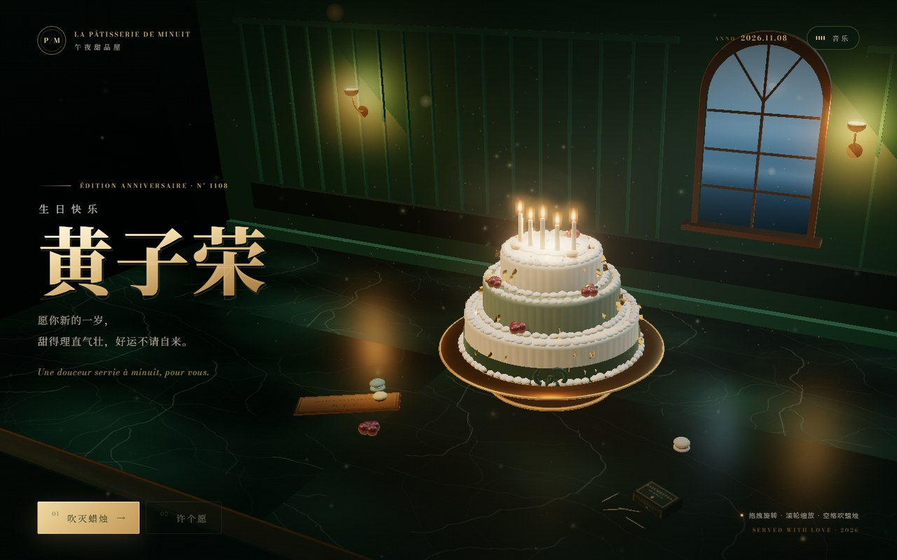

# 午夜甜品屋 · 给黄子荣的 3D 生日蛋糕 🎂

> **La Pâtisserie de Minuit** — 深夜打烊的甜品店，只为他留一盏灯、一块蛋糕。
>
> **线上地址：** <https://mousemaster114.github.io/zirong-birthday/>

一个纯静态、零构建的 3D 生日祝福网站。深夜法式甜品店里，黄铜餐盖下罩着三层奶油蛋糕；
亲手掀开餐盖、点亮蜡烛、吹灭烛火，看金箔与烟花在墨绿色店里炸开，最后收到一张金箔许愿菜单。



## 交互流程

1. **掀开餐盖** — 点击火漆按钮，玻璃餐盖升起、雾气散开，蜡烛依次点亮，音乐盒版《生日快乐》响起。
2. **观察蛋糕** — 拖拽旋转、滚轮缩放；手机单指旋转、双指缩放。空闲时镜头会极慢地自动环绕。
3. **吹灭蜡烛** — 点击「吹灭蜡烛」或按空格；烛火熄灭、烛烟升起。
4. **庆祝** — 黄铜「HAPPY BIRTHDAY」字牌升起，金箔雨与暖金烟花齐放，音乐加入弦乐铺底。
5. **许个愿** — 打开金箔菜单卡，收下三行「今日供应」的祝福；关闭后回到蛋糕。
6. **再看一次** — 随时重播整段仪式；右上角「音乐」可静音，偏好会被记住。

## 本地预览

站点无需构建，但使用原生 ES Module，**必须通过 HTTP 访问**（直接双击 `index.html` 会因 CORS 无法加载模块）：

```bash
cd zirong-birthday
python -m http.server 8090
# 浏览器打开 http://127.0.0.1:8090/
```

也可以用 `npx serve .` 或任意静态文件服务器。

## 目录结构

```
zirong-birthday/
├── index.html          # DOM 结构 + importmap + SEO/OG + 静态兜底
├── styles.css          # 设计系统、布局、动效、响应式
├── js/
│   ├── bus.js          # 事件总线 + 全局状态（模块间唯一通信方式）
│   ├── scene.js        # three.js：甜品店、三层蛋糕、餐盖、烛光、字牌
│   ├── fx.js           # Canvas 2D：金尘、雾气、烛烟、金箔雨、烟花
│   ├── audio.js        # WebAudio：音乐盒版《生日快乐》与全部音效
│   ├── ui.js           # HUD / 入场卡 / 许愿卡 / 键盘 / 按钮状态
│   └── main.js         # 总编排：状态机与各层调用
├── vendor/three/       # three.js r160（本地 vendored，零 CDN）
├── assets/
│   ├── fonts/          # Noto Serif SC 子集 + Bodoni Moda（本地 woff2）
│   ├── favicon.svg
│   └── og.png          # 1200×630 分享图
├── docs/superpowers/specs/  # 设计文档
├── DESIGN.md           # 完整设计系统与场景规格
├── CONTRACT.md         # 模块契约
├── .nojekyll           # 关闭 GitHub Pages 的 Jekyll 处理
└── README.md
```

> `qa/` 是本地的截图、测试页与测试脚本目录，已加入 `.gitignore`，不参与发布。

## 技术栈

- **three.js r160**（本地 vendored，零 CDN、零构建）：WebGL 场景、OrbitControls、程序化 PMREM 环境、
  UnrealBloom 后处理、ACES Filmic tone mapping。
- **WebAudio**：程序化合成的音乐盒、暖 pad、拨弦贝斯、黑胶底噪与音效，无任何音频文件依赖。
- **Canvas 2D**：独立特效层的金尘、雾气、烛烟、金箔雨与烟花。
- 原生 **ES Module + importmap**，无框架、无打包步骤。
- 本地字体子集（Noto Serif SC 约 315 字形 / 105KB，Bodoni Moda 3 个 woff2），不依赖 Google Fonts。

字体与 three.js 的许可说明见 [`assets/fonts/LICENSE.md`](./assets/fonts/LICENSE.md) 与 [`vendor/three/LICENSE`](./vendor/three/LICENSE)。

## 个性化修改

- **名字与文案**：在 `index.html` 中搜索「黄子荣」；祝福语见 `.hero__sub`、`.wish__note`、`.menu`。
- **3D 字牌 / 名牌文字**：见 `js/scene.js` 中绘制 CanvasTexture 的字符串。
- **分享图**：替换 `assets/og.png`（1200×630），并同步 `index.html` 的 `og:image` / `twitter:image`。
- **配色 / 字体**：统一在 `styles.css` 顶部的 `:root` token 中修改；3D 场景同名色值在 `js/scene.js` 顶部。

## 兼容性

- 需要支持 importmap 的现代浏览器：Chrome / Edge 最新版、Safari 16.4+。
- WebGL 不可用、模块加载失败或浏览器过旧时，会显示静态祝福页，祝福仍然送达。
- 低帧率设备会自动降级（限制渲染像素比、简化泛光），保证基本流畅。
- 尊重 `prefers-reduced-motion`：取消自动环绕、减少粒子与镜头运动，流程仍完整。

## 部署

推送到 `main` 后，GitHub Pages（legacy build，main 分支根目录）会自动构建并发布，通常 1 分钟内生效。
